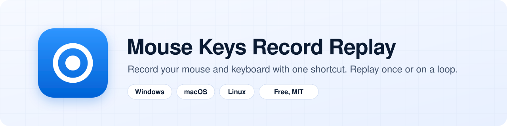

<p align="center">
  <a href="https://mouserec.com">
    <picture>
      <source media="(prefers-color-scheme: dark)" srcset="assets/banner-dark.svg">
      <source media="(prefers-color-scheme: light)" srcset="assets/banner-light.svg">
      
    </picture>
  </a>
</p>

<p align="center">
  <a href="https://github.com/tiktool/mouse-keys-record-replay/releases/latest"></a>
  <a href="https://github.com/tiktool/mouse-keys-record-replay/actions/workflows/build.yml"></a>
  <a href="LICENSE"></a>
  
</p>

A small tray app that records what your mouse and keyboard do and plays it back, once or on a loop. One shortcut to record, one to play, one to loop. No editor to learn, no account to make.

<p align="center">
  
</p>

## How it works

1. **Record.** Press `Ctrl+Alt+Shift+F1` and do the task once. Press it again to stop.
2. **Play.** Press `Ctrl+Alt+Shift+F2` to play the recording once.
3. **Loop.** Press `Ctrl+Alt+Shift+F3` to repeat it until you stop it.

Touch the mouse or press any key and playback stops right away, so you always stay in control.

## Install

Paste this into a terminal:

**Windows** (PowerShell)

```powershell
irm https://mouserec.com/install.ps1 | iex
```

**macOS and Linux**

```sh
curl -fsSL https://mouserec.com/install.sh | sh
```

Or download the latest release:

| Platform | Download |
| --- | --- |
| Windows 10 and 11 (x64) | [mouse-keys-record-replay-windows-x64.exe](https://github.com/tiktool/mouse-keys-record-replay/releases/latest/download/mouse-keys-record-replay-windows-x64.exe) |
| macOS 11 or later (Apple silicon and Intel) | [mouse-keys-record-replay-macos.zip](https://github.com/tiktool/mouse-keys-record-replay/releases/latest/download/mouse-keys-record-replay-macos.zip) |
| Linux x64 (X11) | [mouse-keys-record-replay-linux-x64](https://github.com/tiktool/mouse-keys-record-replay/releases/latest/download/mouse-keys-record-replay-linux-x64) |

Both install scripts check the release signature before they install anything. The Windows build is not code-signed and the macOS app is not notarized, so the first launch may show a system warning. On macOS the app asks for Accessibility and Input Monitoring access, which it needs to record and replay input.

## Features

- **One shortcut per action.** Record, play once and loop, all from the keyboard. Shortcuts can be changed in Settings.
- **Mouse and keyboard together.** Moves, clicks, scrolls, drags and key presses are captured with their original timing.
- **Stops when you move.** Any real mouse or keyboard input ends playback instantly.
- **Random timing.** An optional toggle shifts each press up to half a second early or late on every run, so loops do not repeat with machine precision. Positions stay exactly where you recorded them.
- **Lives in the tray.** Starts at login, stays out of the way and shows a status card on every monitor while it records, when a recording is saved and while it loops. The card never takes focus and lets clicks pass through.
- **Follows your theme.** Light and dark mode match your system.
- **Signed updates.** The app updates itself from this repository's releases and only installs a download whose Ed25519 signature checks out.
- **Small and native.** A single Rust binary with no runtime to install.

## Shortcuts

| Action | Windows and Linux | macOS |
| --- | --- | --- |
| Start or stop recording | `Ctrl+Alt+Shift+F1` | `Cmd+Option+Shift+F1` |
| Play once | `Ctrl+Alt+Shift+F2` | `Cmd+Option+Shift+F2` |
| Loop | `Ctrl+Alt+Shift+F3` | `Cmd+Option+Shift+F3` |
| Playback speed 1/4x, 1/2x, 1x, 2x, 4x, custom | `Ctrl+Alt+Shift+F5` to `F10` | `Cmd+Option+Shift+F5` to `F10` |
| Stop playback | Move the mouse or press any key | Move the mouse or press any key |

## Privacy

There is no account and no sign-in. Recordings and settings stay on your computer. The only network request the app makes is the update check against this repository's GitHub releases, and you can turn automatic updates off in Settings.

## Limits

- Linux support is X11 only. Wayland sessions are not supported.
- There is no recording editor, no scheduler and no image or color search. It replays exactly what you recorded.
- Playback uses screen positions, so it works best when windows are where they were during recording.

## Build from source

Install Rust with rustup (https://rustup.rs) first, then:

```sh
cargo build --release
```

Linux needs the GTK 3, AppIndicator, xdo and X11 development packages, for example on Ubuntu:

```sh
sudo apt install libgtk-3-dev libayatana-appindicator3-dev libxdo-dev libx11-dev libxi-dev libxtst-dev
```

### macOS app bundle

`cargo build` on macOS gives a bare binary, while the release ships an app bundle. This wraps the binary into `Mouse Keys Record Replay.app` with the Info.plist and icon from `packaging/macos`, signs it ad hoc and zips it with `ditto`:

```sh
cargo build --release
sh packaging/macos/bundle.sh target/release/mouse-keys-record-replay dist
codesign --verify --verbose "dist/Mouse Keys Record Replay.app"
```

The release build is universal (Apple silicon and Intel). To make the same binary, build both targets and join them with `lipo` before bundling:

```sh
rustup target add aarch64-apple-darwin x86_64-apple-darwin
export MACOSX_DEPLOYMENT_TARGET=11.0
cargo build --release --target aarch64-apple-darwin
cargo build --release --target x86_64-apple-darwin
mkdir -p dist
lipo -create -output dist/mouse-keys-record-replay \
  target/aarch64-apple-darwin/release/mouse-keys-record-replay \
  target/x86_64-apple-darwin/release/mouse-keys-record-replay
sh packaging/macos/bundle.sh dist/mouse-keys-record-replay dist
```

The app ends up in `dist/Mouse Keys Record Replay.app` and the zip in `dist/mouse-keys-record-replay-macos.zip`.

## Links

- Website: [mouserec.com](https://mouserec.com)
- License: [MIT](LICENSE)

If it saves you some clicks, a star on this repository helps other people find it.
